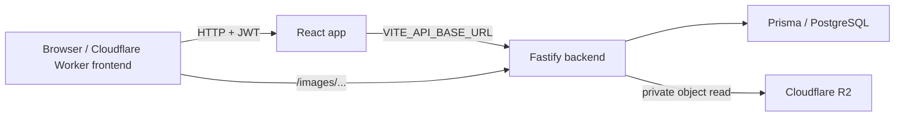

# Architecture

## System overview

The project is split into a React frontend and a Fastify backend.

- Frontend: Vite + React + React Router, built for Cloudflare Workers Static Assets.
- Backend: Fastify + Prisma + PostgreSQL.
- Catalog images: `/images/...` keys resolve through the backend to private Cloudflare R2 objects; the backend does not serve catalog files from local disk.
- Uploads: the app supports private S3-compatible object storage and fails closed unless the environment is explicitly configured.

## Request flow

## Frontend details

The frontend runtime API base is driven by `VITE_API_BASE_URL` in [src/config/runtime.ts](../src/config/runtime.ts). The Axios client in [src/api/client.ts](../src/api/client.ts) sets the base URL and attaches bearer tokens from local/session storage.

Image URLs are normalized in [src/utils/imageValidation.ts](../src/utils/imageValidation.ts) so that local `/images/...` paths are resolved against the configured API origin, while dangerous or external image URLs are rejected. The SafeImage component in [src/components/ui/safe-image.tsx](../src/components/ui/safe-image.tsx) falls back to a local asset or a blank state if the selected image fails.

## Backend details

The backend boots in [backend/src/main.ts](../backend/src/main.ts). It:

- registers CORS using [backend/src/cors.ts](../backend/src/cors.ts)
- enforces the staging read-only guard from [backend/src/staging-write-guard.ts](../backend/src/staging-write-guard.ts)
- mounts static `/images/` files from `backend/public/Images`
- registers auth, catalog, dashboard, upload, admin, event, and search routes

Route registration is intentionally separated by domain. Upload safety and storage selection are centralized in [backend/src/uploads/upload-storage.ts](../backend/src/uploads/upload-storage.ts) and [backend/src/uploads/uploads.controller.ts](../backend/src/uploads/uploads.controller.ts).

## Database and auth

The backend expects a Postgres connection via `DATABASE_URL`. Prisma is initialized on startup in [backend/src/main.ts](../backend/src/main.ts) and the app uses JWT-based bearer auth for protected routes.

The staging guard ensures write routes remain blocked unless `DATABASE_WRITES_ENABLED=true`. Login is explicitly exempt so read-only checks can still verify auth behavior without writing to the database.

## Storage model

The project has two storage categories:

1. Catalog object-key metadata and database references
2. Upload metadata in Prisma, with image bytes stored in the explicitly configured object-storage driver

Catalog binaries are read from private R2 through the backend route. The object-store path is implemented in [backend/src/uploads/upload-storage.ts](../backend/src/uploads/upload-storage.ts), and catalog key metadata is in [backend/src/images/catalog-image-keys.json](../backend/src/images/catalog-image-keys.json). The backend fails closed rather than falling back to local catalog files when R2 is unavailable.

## Important safety constraints

- Production remains untouched.
- The staging write guard is intentionally strict and should stay enabled unless an isolated staging database is confirmed.
- The candidate-only CORS gate remains off by default.
- The R2 bucket must remain private; browser clients should not access object storage directly.

## Verified vs unverified

Verified locally:

- frontend TypeScript passes
- frontend production build passes
- targeted backend upload/staging tests pass
- the repo status and dashboard branch are preserved

Not verified live:

- actual Hostless backend revision
- actual staging database identity
- actual Cloudflare R2 connection and bucket permissions
- real admin login against a confirmed staging database
